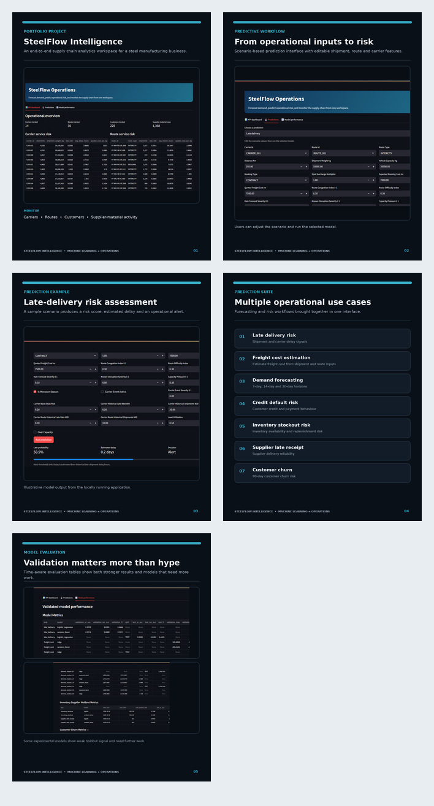
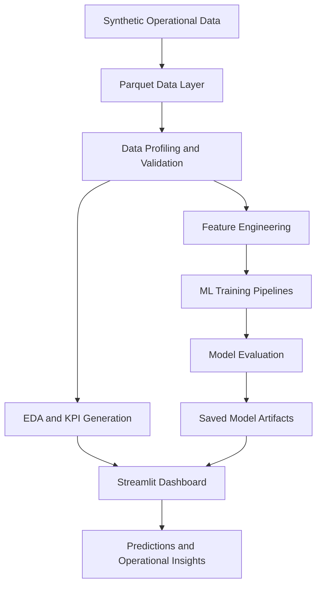

# SteelFlow Intelligence
### End-to-End Supply Chain Analytics & Machine Learning Platform

SteelFlow Intelligence is an end-to-end data analytics and machine learning project built around a simulated steel manufacturing business.

## Application Preview


The platform brings together operational data, business intelligence, predictive modeling and an interactive dashboard to explore supply chain performance and anticipate operational risks.

It covers multiple aspects of manufacturing operations, including demand, sales, factories, inventory, logistics, delivery performance, suppliers, receivables and customer risk.

**Project Status:** V1 Complete | V2 Planned

---


## Key Features

### 1. Data Engineering & Analytics
- Profiled and documented 69 Parquet tables.
- Built data-flow and table-grain documentation.
- Developed KPI-first exploratory data analysis workflows.
- Generated operational KPIs for carriers, routes, customers, warehouses and suppliers.
- Created rendered HTML reports for exploring analytical results.

### 2. Machine Learning

Implemented and evaluated multiple machine learning pipelines across different operational use cases.

| Business Problem | ML Approach |
|---|---|
| Late-delivery prediction | Logistic Regression, Random Forest |
| Freight-cost estimation | Ridge Regression, Random Forest |
| Demand forecasting | Seasonal Naive, Ridge, Random Forest |
| Inventory stockout risk | Logistic Regression, Random Forest |
| Supplier late-receipt risk | Logistic Regression, Random Forest |
| Customer churn prediction | Logistic Regression, Random Forest |
| Credit-default risk | Classification pipeline |

Demand forecasting supports 7-day, 14-day and 30-day horizons.

### 3. Interactive Dashboard

Built using Streamlit, the application provides:

- Operational KPI dashboard.
- Carrier and route performance analysis.
- Customer and supplier performance tables.
- Interactive prediction interface.
- Configurable model input scenarios.
- Estimated delivery delay and risk outputs.
- Model performance and evaluation reports.

### 4. Model Evaluation & Management

- Chronological validation for forecasting workflows.
- Classification evaluation using PR-AUC, ROC-AUC, precision, recall and F1.
- Regression evaluation using MAE and RMSE.
- Comparison against baseline models.
- Saved preprocessing and prediction pipelines.
- Model registry and artifact health checks.

---

## System Architecture



---

## Project Structure

```text
SteelFlow-Intelligence/
│
├── app.py
├── requirements.txt
├── Dockerfile
├── README.md
│
├── data/
│   └── *.parquet
│
├── notebooks/
│   └── EDA and analysis notebooks
│
├── scripts/
│   ├── profile_data.py
│   ├── build_kpis.py
│   ├── train_models.py
│   ├── train_demand_models.py
│   ├── train_customer_credit_risk.py
│   ├── train_inventory_supplier_models.py
│   ├── train_churn_model.py
│   ├── tune_late_threshold.py
│   ├── build_registry.py
│   └── health_check.py
│
├── src/
│   ├── data/
│   ├── features/
│   ├── models/
│   ├── evaluation/
│   ├── pipelines/
│   └── utils/
│
└── artifacts/
    ├── eda/
    ├── kpis/
    └── models/
```

*Note: The `src/` layout represents the planned organization for reusable application modules. Update it to reflect the actual files as you migrate the existing implementation.*

---

## Tech Stack

| Category | Technologies |
|---|---|
| Language | Python |
| Data Processing | Pandas, NumPy |
| Data Storage | Parquet |
| Query Engine | DuckDB |
| Machine Learning | Scikit-learn |
| Visualization | Matplotlib, Streamlit |
| Model Persistence | Joblib |
| Deployment | Docker |

---

## Getting Started

### 1. Clone the repository

```bash
git clone https://github.com/Atharva97l/SteelFlow-Intelligence.git
cd SteelFlow-Intelligence
```

### 2. Create a virtual environment

Windows PowerShell:

```powershell
python -m venv .venv
.venv\Scripts\Activate.ps1
```

### 3. Install dependencies

```powershell
pip install -r requirements.txt
```

Ensure the required Parquet files are available in the `data/` directory.

### 4. Generate EDA and KPIs

```powershell
python scripts/profile_data.py
python scripts/build_kpis.py
```

Open the generated report:

```text
artifacts/eda/index.html
```

### 5. Train models

Run the training workflows individually:

```powershell
python scripts/train_models.py
python scripts/train_demand_models.py
python scripts/train_customer_credit_risk.py
python scripts/train_inventory_supplier_models.py
python scripts/train_churn_model.py
python scripts/tune_late_threshold.py
python scripts/build_registry.py
python scripts/health_check.py
```

Existing saved `.joblib` artifacts can be used without retraining, provided the required files and compatible dependencies are available.

### 6. Launch the application

```powershell
streamlit run app.py
```

Open:

http://localhost:8501

---

## Model Evaluation

Selected evaluation results from the current model experiments:

| Use Case | Metric | Result |
|---|---|---:|
| Late delivery | Test PR-AUC | 0.3285 |
| Late delivery | Test ROC-AUC | 0.6301 |
| Late delivery | Test F1 | 0.4425 |
| Freight cost | Test MAE | ₹196.48 |
| Freight cost | Test RMSE | ₹439.65 |
| Demand forecasting | Test WAPE | ~181% |
| Inventory stockout | Holdout PR-AUC | 0.9937 |
| Inventory stockout | Holdout ROC-AUC | 0.9988 |
| Supplier late receipt | Holdout PR-AUC | 0.694 |
| Supplier late receipt | Holdout ROC-AUC | 0.513 |
| Customer churn | Holdout PR-AUC | 0.0981 |
| Customer churn | Holdout ROC-AUC | 0.509 |

### Evaluation Considerations

Model performance is not uniform across use cases.

- **Late delivery:** Moderate predictive discrimination; suitable for further development as a human-reviewed alerting workflow.
- **Freight cost:** Ridge Regression provides a useful baseline for cost estimation.
- **Demand forecasting:** Current WAPE indicates substantial forecasting error. Predictions should be treated as experimental estimates.
- **Inventory stockout:** Very high holdout scores require additional investigation for potential data leakage and target construction issues.
- **Supplier late receipt:** Experimental due to weak ROC-AUC and limited holdout observations.
- **Customer churn:** Current predictive performance is weak.
- **Credit default:** Requires stronger chronological holdout validation.

PR-AUC, ROC-AUC, precision, recall and F1 are used for classification evaluation. MAE, RMSE and WAPE are used for regression and forecasting.

All evaluation results should be interpreted in the context of their respective validation splits and class distributions.

---

## Docker

Build the Docker image:

```powershell
docker build -t steelflow-ml .
```

Run the container:

```powershell
docker run --rm -p 8501:8501 steelflow-ml
```

Open:

http://localhost:8501

Validate model artifacts:

```powershell
python scripts/health_check.py
```

Docker provides a containerized way to run the application locally or in a compatible deployment environment.

---

## Current Limitations

- The project uses synthetic operational data rather than live company data.
- Demand forecasting requires further improvement.
- Inventory stockout results require additional leakage validation.
- Supplier and customer-risk models remain experimental.
- Credit-default evaluation requires a stronger chronological holdout.
- Production deployment monitoring and automated model retraining are not yet implemented.

---

## Future Improvements | V2

Planned enhancements include:

- Richer interactive visualizations and operational reporting.
- Automated time-based and seasonality-aware suggestions.
- LLM-powered operational reviews and summaries.
- LLM integration with existing ML prediction pipelines.
- Natural-language interaction with supply chain analytics.
- Explainable predictions and recommended operational actions.
- Model drift monitoring and automated performance reporting.

---

## Author

**Atharva Kulkarni**

GitHub: https://github.com/Atharva97l

---

*SteelFlow Intelligence is an experimental portfolio project demonstrating data engineering, business analytics, machine learning and interactive application development. Model outputs are intended for exploration and decision support, not autonomous operational decisions.*
